# Comprehensive Architectural Plan: PK-POS Enterprise Super Admin Panel

> **Status**: Completed — All 17 Enterprise Modules Built, Fully Verified & Integrated  
> **Test Suite**: 192 Feature Tests Passing (1,146 Assertions)  
> **Architecture**: Laravel 11 + Inertia.js + Vue 3 (Single-Database Multi-Tenant)  
> **Guiding Principle**: Dependency-first implementation, ensuring data integrity, desktop client version control, and fiscal compliance at each stage.

---

## 1. Executive Implementation Sequence & Dependency Graph

Modules are arranged in **strict sequential order** based on functional and technical dependencies:

```mermaid
flowchart TD
    M1["1. Tenant Lifecycle & User Admin<br>(Core Operations)"]
    M2["2. Platform Audit Logging<br>(AGENTS.md Constraint 6)"]
    M3["3. FBR Fiscalization Command Center<br>(Dead-Letter Queue & Health)"]
    M4["4. Master Catalog & HS Codes<br>(Tax Standardization)"]
    M5["5. POS Terminal Fleet Management<br>(Tauri Client Pairing)"]
    M6["6. Changelog & Version Control<br>(Desktop Releases & OTA Updates)"]
    M7["7. Subscriptions & Quota Enforcement<br>(SaaS Monetization)"]
    M8["8. Customer Support & Helpdesk Hub<br>(Ticketing & Diagnostic Snapshots)"]
    M9["9. System Diagnostics & Queue Telemetry<br>(Ops Reliability)"]
    M10["10. Internal Super Admin RBAC<br>(Staff Access Control)"]
    M11["11. Executive Analytics & BI Dashboard<br>(Consolidated Intelligence)"]
    M12["12. Dynamic Roles & Permissions Engine<br>(Granular Matrix & Custom Roles)"]
    M13["13. Platform Broadcasts & Emergency Alerts<br>(FBR Outage Notices & POS Banners)"]
    M14["14. Pakistan SaaS Payment Invoicing<br>(1Bill / Kuickpay / Bank Wire Audit)"]
    M15["15. Merchant Self-Registration & Onboarding<br>(FBR ATL Verification Queue)"]
    M16["16. Automated Backups & Fiscal Data Archiving<br>(6-Year Statutory Compliance)"]
    M17["17. Security Hardening & Session Killswitch<br>(2FA TOTP & Session Telemetry)"]

    M1 --> M2
    M2 --> M3
    M3 --> M4
    M4 --> M5
    M5 --> M6
    M6 --> M7
    M7 --> M8
    M8 --> M9
    M9 --> M10
    M10 --> M11
    M11 --> M12
    M12 --> M13
    M13 --> M14
    M14 --> M15
    M15 --> M16
    M16 --> M17
```

### Why This Exact Sequence?
1. **Module 1 (Tenant Core)**: Prerequisite for all tenant-scoped data and relationships.
2. **Module 2 (Audit Logging)**: Mandated by project architecture (*"Every mutation must write to audit_logs"*). Must be active before mutations occur in subsequent modules.
3. **Module 3 (FBR Fiscalization)**: The mission-critical core of PK-POS in Pakistan (resolving FBR IRIS outages and dead-letter queues).
4. **Module 4 (Master Data)**: Centralized tariff and HS Code schedules that feed product catalogs.
5. **Module 5 (Terminal Fleet)**: Tracking physical Tauri desktop POS machines in retail stores.
6. **Module 6 (Changelog & Version Control)**: Builds on Terminal Fleet to enforce minimum client versions, publish release notes, and distribute OTA desktop updates.
7. **Module 7 (Subscriptions & Quotas)**: Enforces business limits on registered locations and active terminals.
8. **Module 8 (Customer Support & Helpdesk)**: Equipped with tenant diagnostic snapshots and audited impersonation to resolve merchant issues.
9. **Module 9 to 11**: Ops telemetry, internal staff RBAC, and consolidated executive intelligence.

---

## 2. Detailed Module Specifications (Sorted Order)

---

### Module 1: Tenant Lifecycle & User Administration (Build First)
*Goal: Provide full CRUD, staff user management, branch location oversight, and credential recovery for tenants.*

* **Key Deliverables**:
  1. **Tenant Edit Screen (`/superadmin/tenants/{id}/edit`)**:
     * Update Legal Business Name, NTN, STRN, Province, and default FBR POS ID.
     * Toggle active/suspended state with suspension reason note.
  2. **Tenant Staff Directory & Management**:
     * View all users belonging to the tenant (`role: owner, manager, cashier`).
     * Direct action to create an additional staff user or deactivate existing ones.
  3. **Direct Password Reset & Recovery**:
     * Super Admin can trigger a password reset for tenant owners or set a temporary password.
  4. **Multi-Location / Branch Inspector**:
     * List all branches per tenant with address, registered province, and active cashier count.
* **Database Updates**: Add `notes` and `suspension_reason` to `tenants` table.

---

### Module 2: Platform Audit Logging & Security Operations (AGENTS.md Rule 6)
*Goal: Implement immutable audit logging for all platform and tenant mutations across the system.*

* **Key Deliverables**:
  1. **Migration & Model**: Create `audit_logs` table (`id`, `tenant_id`, `user_id`, `event`, `auditable_type`, `auditable_id`, `old_values`, `new_values`, `ip_address`, `user_agent`, `created_at`).
  2. **Eloquent Model Observer / Trait**: `LogsActivity` trait to automatically record creates, updates, and deletes across critical models (`Tenant`, `User`, `Location`, `FbrCredential`, `TaxRule`, `Sale`).
  3. **Super Admin Audit Viewer (`/superadmin/audit-logs`)**:
     * Filter logs by Tenant, User, Event type, and Date range.
     * JSON diff viewer displaying before/after state changes.
* **Risk Addressed**: Fulfills the strict requirement that mutations are non-repudiable and auditable.

---

### Module 3: FBR Fiscalization & Compliance Command Center
*Goal: Monitor national FBR IRIS API health, track provisional receipts, and retry failed invoices.*

* **Key Deliverables**:
  1. **FBR Dead-Letter Queue (DLQ) (`/superadmin/compliance/fbr/failed`)**:
     * Platform-wide list of sales with `fbr_status = 'failed'`.
     * Detailed error inspector (HTTP code, FBR error payload, timestamp).
     * Single and bulk **"Retry FBR Submission"** action.
  2. **Provisional Receipt Expiry Tracker**:
     * Filter offline sales awaiting sync approaching the 24-hour statutory legal limit.
     * Visual warning indicators for non-compliant tenants.
  3. **FBR IRIS Live Health Monitor**:
     * Scheduled ping to FBR IRIS sandbox and production endpoints every 5 minutes.
     * Status indicator in Super Admin header (Online / Degraded / Outage).

---

### Module 4: Master Data & FBR HS Codes Repository
*Goal: Provide a centralized repository of Pakistani HS codes and provincial tax rates.*

* **Key Deliverables**:
  1. **Master HS Code Catalog (`/superadmin/catalog/hs-codes`)**:
     * Directory of standardized Pakistan Customs/FBR Harmonized System (HS) codes.
     * Pre-assigned tax categories (`general_goods`, `tier_1_retail`, `reduced_goods`, `services`).
     * Bulk CSV import for FBR tariff schedules.
  2. **Provincial Tax Rate Templates**:
     * Configured standard rates: FBR (18%), PRA Punjab (16%/5%), SRB Sindh (15%/13%), KPRA, BRA.
     * One-click "Sync Tax Rules to Tenant" button when provincial laws change.

---

### Module 5: POS Terminal Fleet & Hardware Licensing
*Goal: Register, authorize, and remotely manage physical desktop Tauri POS clients.*

* **Key Deliverables**:
  1. **Terminal Registration API (`/api/v1/terminals/register`)**:
     * POS desktop client sends hardware UUID, hostname, app version, and branch ID during initial setup.
  2. **Terminal Fleet Directory (`/superadmin/terminals`)**:
     * View all active cash registers across Pakistan with tenant name, branch, app version, and last heartbeat.
  3. **Remote Revocation & Terminal Locking**:
     * Super Admin can deactivate a compromised or decommissioned POS register with one click.
  4. **Client Version Distribution Tracker**:
     * Highlights terminals running outdated versions of `pos-client`.

---

### Module 6: Changelog & Release Version Control (NEW)
*Goal: Manage platform releases, publish rich markdown release notes, distribute Tauri OTA updates, and enforce client versions.*

* **Key Deliverables**:
  1. **Release Management Dashboard (`/superadmin/releases`)**:
     * Create and publish version releases for **Cloud Backend** and **Desktop POS Client** (e.g. `v0.2.0`, `v1.0.0`).
     * Metadata: Version number, release date, download URLs (Windows `.msi`/`.exe`), SHA-256 checksums, and update signature.
  2. **Rich Markdown Changelog Editor**:
     * Structured categorizations: `Features`, `FBR Fiscal Updates`, `Performance`, `Bug Fixes`, `Deprecations`.
     * Preview mode for in-app display.
  3. **Tauri Over-The-Air (OTA) Update Manifest Endpoint**:
     * Endpoint: `GET /api/v1/updates/desktop/{target}/{current_version}`
     * Serves the official Tauri v2 auto-updater JSON response with release notes and binary download paths.
  4. **Minimum Supported Version Enforcement**:
     * Super Admin can configure `min_pos_client_version` (e.g. `0.2.0`).
     * When an obsolete terminal connects, the sync engine flags it with an update warning to prevent incompatible FBR schema submissions.
  5. **Merchant Release Notification**:
     * "What's New" modal broadcasted inside the Tenant portal and desktop POS client when a new release goes live.

---

### Module 7: SaaS Subscriptions, Pricing Tiers & Quota Enforcement
*Goal: Monetize the platform through tiered plans and enforce location/terminal quotas.*

* **Key Deliverables**:
  1. **Plans & Subscription Engine**:
     * Tiers: `Starter` (1 Branch, 1 Terminal), `Retail Growth` (3 Branches, 5 Terminals), `Enterprise` (Unlimited).
     * Track subscription status: `active`, `past_due`, `canceled`.
  2. **Quota Enforcement Middleware**:
     * Guard adding extra branch locations or pairing new POS terminals when a tenant exceeds plan limits.
  3. **Subscription Management UI (`/superadmin/tenants/{id}` & `/superadmin/plans`)**:
     * Assign, upgrade, or extend tenant subscription terms directly from the panel.

---

### Module 8: Customer Support & Helpdesk Hub (NEW)
*Goal: Provide a first-class ticketing and troubleshooting experience for merchant support.*

* **Key Deliverables**:
  1. **Support Ticketing Central (`/superadmin/support/tickets`)**:
     * Centralized queue of tickets submitted by merchants (via web admin or POS screen).
     * Categorization: `FBR Sync Failure`, `Hardware/Printer`, `Tax Calculation`, `Account & Billing`, `General`.
     * Prioritization: `Critical (POS Counter Down)`, `High`, `Medium`, `Low`.
  2. **Automated Diagnostic Snapshot**:
     * Each ticket automatically attaches a non-sensitive snapshot of the merchant's environment:
       * Tenant NTN/STRN, Province, assigned FBR POS ID.
       * Affected Terminal Hardware UUID & App Version.
       * Local SQLite pending outbox count and last FBR error code.
  3. **Staff Response Thread & Internal Notes**:
     * Conversation thread between merchant and support agent with attachment support (screenshots/receipt photos).
     * Private internal staff notes visible only to Super Admins.
  4. **One-Click Support Impersonation**:
     * Direct button on the ticket to jump into the tenant's account via the existing audited [`ImpersonationController`](file:///c:/laragon/www/pk-pos/pk-pos-f/backend/app/Http/Controllers/SuperAdmin/ImpersonationController.php) to troubleshoot immediately.
  5. **Knowledge Base / Playbooks (`/superadmin/support/knowledge-base`)**:
     * Canned solutions for common Pakistani POS hurdles (e.g. FBR Token refresh, thermal printer baud rate setup, Windows USB driver issues).

---

### Module 9: System Diagnostics, Queue & Database Telemetry (COMPLETED)
*Goal: Monitor platform infrastructure, background workers, and PostgreSQL health.*

* **Key Deliverables**:
  1. **Queue & Job Monitor (`/superadmin/system/jobs`)**:
     * Real-time view of Laravel failed jobs (`failed_jobs` table).
     * Stack trace viewer modal, single job retry, bulk retry-all, and purge/flush actions.
  2. **Database & Storage Health (`/superadmin/system/health`)**:
     * PostgreSQL database size, connection latency benchmark (ms), and table row counts across all key tables.
     * PHP runtime configuration, memory allocation, and environment status.
  3. **API Sync Throughput**:
     * 24-hour transaction sync throughput telemetry aggregated hourly across all retail merchants.

---

### Module 10: Super Admin Role-Based Access Control (Internal RBAC) (COMPLETED)
*Goal: Divide Super Admin permissions into roles for platform team members.*

* **Key Deliverables**:
  1. **Internal Staff Roles**:
     * `Super Admin`: Full system access, tenant suspension, billing plans, system queues, staff management, and release publishing.
     * `Support Agent`: Merchant helpdesk triage, ticket replies, internal staff notes, merchant staff password resets, terminal inspection, and audited impersonation.
     * `Compliance Auditor`: Read-only access to FBR Dead-Letter Queue, 24h provisional receipts, master HS codes, tax rate templates, and platform audit logs.
  2. **Super Admin User Directory (`/superadmin/staff`)**:
     * Manage platform staff accounts, assign internal roles, reset credentials, and toggle account activation status.
     * Safety controls preventing self-demotion, self-deactivation, or removal of the last active Super Admin.
  3. **Role-Enforced Navigation & Middleware**:
     * `EnsureStaffRole` middleware protecting administrative routes based on granular permissions.
     * Dynamic sidebar navigation and role badges adapting to the authenticated staff member.

---

### Module 11: Executive Analytics & Platform Intelligence Dashboard (COMPLETED)
*Goal: Consolidate data from all previous modules into an executive command center.*

* **Key Deliverables**:
  1. **Platform GMV & Revenue Analytics**:
     * Total processed GMV across Pakistan and 30-day sales volume in Pakistani Rupees (`PKR`).
     * 14-day interactive GMV trajectory visualizer with daily breakdown.
     * Provincial revenue breakdown (Punjab, Sindh, KPK, Islamabad, Balochistan).
  2. **FBR Fiscal Compliance Visualizer**:
     * Real-time compliance health score: % Verified vs % Pending vs % DLQ Failed vs % Provisional.
     * Quick-action alert pill linking directly to the Dead-Letter Queue.
  3. **Top Merchant Ranking**:
     * Top retail merchants ranked by transaction GMV volume, invoice count, and active hardware fleet.
  4. **Active Hardware Fleet & Support Backlog Telemetry**:
     * Real-time counters for active desktop Tauri POS terminals and open customer support cases.
  5. **Recent Onboarded Merchants Directory**:
     * Direct overview of recently registered retail tenants with NTN, province, and quick-management actions.

---

### Module 12: Dynamic Roles & Granular Permissions Engine (COMPLETED)
*Goal: Empower platform administrators with custom operational roles and granular permission controls.*

* **Key Deliverables**:
  1. **Granular Platform Capability Matrix (`/superadmin/roles`)**:
     * 30+ fine-grained permissions mapped across all 11 modules (Tenants, FBR, Master Data, Terminals, Releases, Plans, Support, System, Staff, Roles, Audit).
     * Grouped capability checklist with module-level batch toggle.
  2. **Custom Role Authoring & Management**:
     * Create, edit, and delete operational roles with custom colors, slugs, and descriptive scopes.
     * System role protections (`is_system = true`) preventing deletion of core roles (`super_admin`, `support_agent`, `compliance_auditor`).
     * Active assignment safeguards preventing deletion of roles assigned to active staff members.
  3. **Multi-Role Assignment in Staff Directory (`/superadmin/staff`)**:
     * Dynamic role dropdown populated from the database with real-time color badge rendering.
  4. **Authorization Middleware & Gates**:
     * `EnsurePermission` middleware and `User::hasPermission()` capability evaluation with Super Admin wildcard access.

---

### Module 13: Platform Broadcasts, Emergency Banners & Merchant Notifications (In Progress)
*Goal: Transmit critical announcements, FBR portal maintenance warnings, and emergency counter alerts to merchants and physical desktop POS terminals.*

* **Key Deliverables**:
  1. **Broadcast Management Command Center (`/superadmin/broadcasts`)**:
     * Create, schedule, and publish platform announcements with visual urgency levels: `Info`, `Warning`, `Critical Emergency (Counter Alert)`.
     * Targeting filters: `All Merchants`, `Specific Province (e.g. Sindh SRB notice)`, `Desktop POS Cash Registers`, or `Single Retailer`.
  2. **Active Broadcasts API for Desktop Clients (`/api/v1/broadcasts/active`)**:
     * Serves active notices to Tauri desktop clients and merchant portals with province/terminal matching.
  3. **Merchant Portal In-App Emergency Banner**:
     * Dismissible, high-visibility notification bar rendered at the top of merchant layouts for critical FBR server outages or regulatory updates.

---

### Module 14: Pakistan SaaS Payment Invoicing & B2B Billing Gateway
*Goal: Automate subscription monetization through Pakistani payment rails (1Bill, Kuickpay, JazzCash/Easypaisa, and manual bank wire proof review).*

* **Key Deliverables**:
  1. **SaaS Invoicing & Consumer Number Generation**:
     * Automated generation of official B2B subscription tax invoices with PK-POS STRN/NTN.
     * 1Link 1Bill & Kuickpay consumer bill number generation for ATM/mobile banking payments.
  2. **Manual Bank Transfer Slip Verification Queue**:
     * Review uploaded payment deposit slips, one-click verify, and automatically extend tenant plan validity.
  3. **Automated Dunning & Suspension Grace Engine**:
     * Configurable grace period before automatic POS sync suspension on overdue invoices.

---

### Module 15: Public Merchant Self-Registration & Onboarding Approval Queue
*Goal: Streamline retailer onboarding with an automated sign-up flow and FBR ATL taxpayer verification queue.*

* **Key Deliverables**:
  1. **Merchant Application Review Queue (`/superadmin/onboarding`)**:
     * Review prospective retail merchants applying via public sign-up.
     * Automated or manual verification against FBR Active Taxpayer List (ATL).
  2. **One-Click Provisioning Engine**:
     * Generates tenant database records, provisions default location, sets starter subscription, creates primary owner credentials, and dispatches welcome onboarding email.

---

### Module 16: Automated Backups & Fiscal Data Archiving (6-Year Statutory Retention)
*Goal: Guarantee regulatory compliance under Pakistan Sales Tax Act (6-year records retention) and disaster recovery.*

* **Key Deliverables**:
  1. **Database Snapshot & Backup Manager (`/superadmin/system/backups`)**:
     * Automated daily/weekly PostgreSQL dumps with disk usage and offsite storage status.
  2. **Merchant Fiscal Year Exporter**:
     * One-click encrypted ZIP export of a retailer's complete sales ledger, FBR invoice numbers, response codes, and operator audit trail for tax audits.

---

### Module 17: Platform Security Hardening: Two-Factor Authentication (2FA) & Session Killswitch
*Goal: Safeguard administrative access with multi-factor authentication and emergency session control.*

* **Key Deliverables**:
  1. **Mandatory 2FA (TOTP) for Platform Staff**:
     * Google Authenticator / Microsoft Authenticator time-based one-time passwords for super admin login.
  2. **Active Staff Sessions Inspector & Platform Killswitch**:
     * View live staff sessions with IP address, browser user-agent, and last activity.
     * Emergency "Kill All Sessions" button revoking all active platform authentication tokens instantly.

---

## 3. Database Schema Migration Plan

Migrations will be created in this exact sequence:

| Step | Migration File | Target Table(s) | Purpose |
| :---: | :--- | :--- | :--- |
| **1** | `2026_11_04_000001_create_audit_logs_table.php` | `audit_logs` | Immutable audit logging (Module 2) |
| **2** | `2026_11_04_000002_add_admin_fields_to_tenants_table.php` | `tenants` | Add `notes`, `suspension_reason` (Module 1) |
| **3** | `2026_11_04_000003_create_master_hs_codes_table.php` | `master_hs_codes` | Standard FBR HS Code catalog (Module 4) |
| **4** | `2026_11_04_000004_create_pos_terminals_table.php` | `pos_terminals` | Hardware tracking and authorization (Module 5) |
| **5** | `2026_11_04_000005_create_releases_and_changelogs_tables.php` | `releases`, `changelog_items` | Version control & OTA update manifests (Module 6) |
| **6** | `2026_11_04_000006_create_plans_and_subscriptions_tables.php` | `plans`, `subscriptions` | SaaS monetization and quotas (Module 7) |
| **7** | `2026_11_04_000007_create_support_tickets_tables.php` | `support_tickets`, `support_messages` | Helpdesk ticketing & diagnostics (Module 8) |
| **8** | `2026_11_04_000008_add_staff_role_to_super_admins.php` | `users` | Add `super_admin_role` enum for staff RBAC (Module 10) |

---

## 4. Implementation Next Steps

We will begin execution starting with **Module 1 & Module 2**:
1. Add `notes` and `suspension_reason` to `tenants` and build the Tenant Edit & Staff management interface.
2. Create the `audit_logs` migration and `LogsActivity` trait so every subsequent action is automatically audited.
